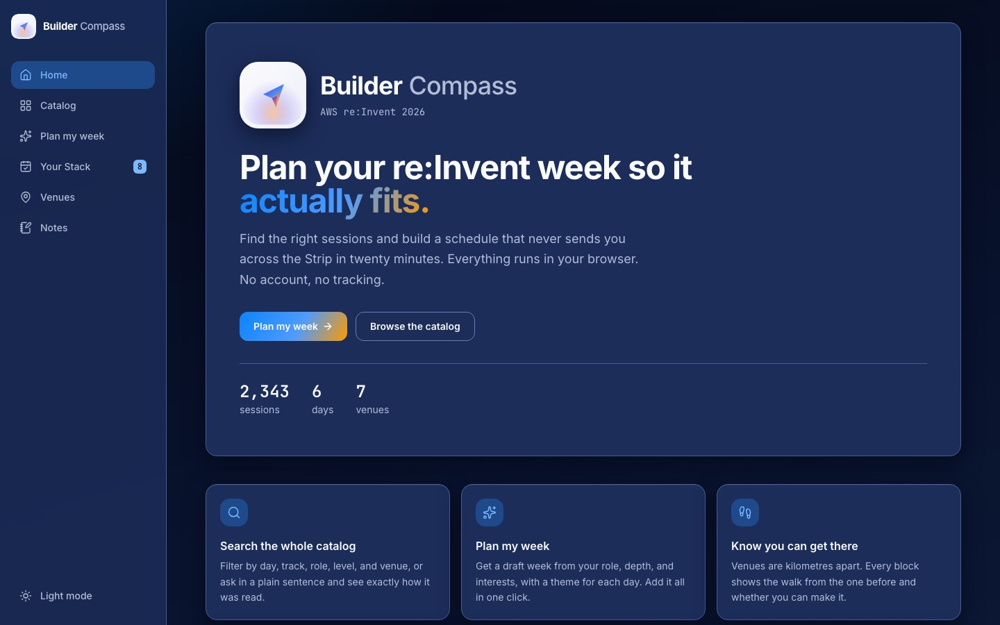
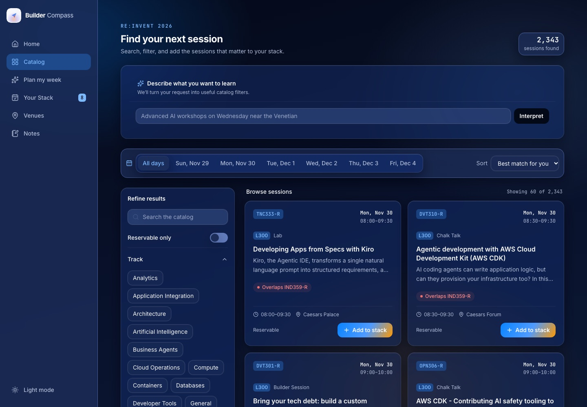
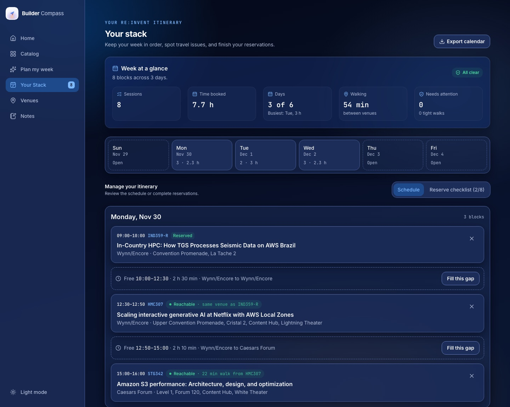
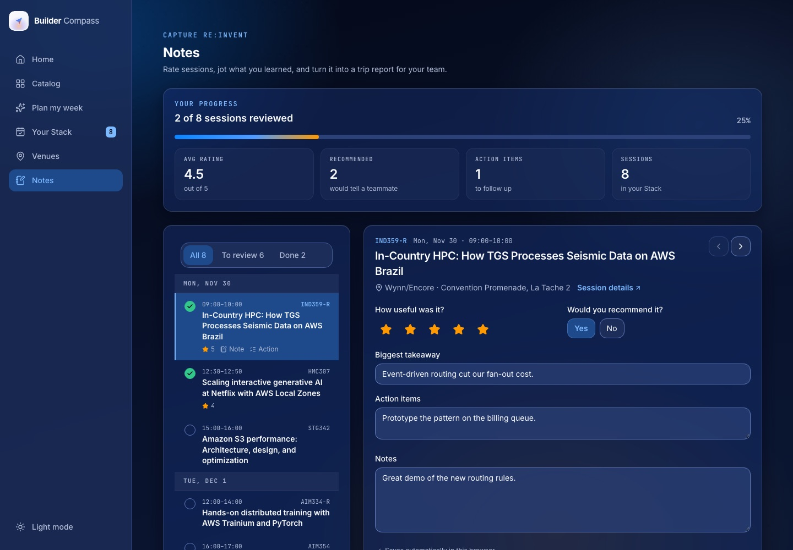
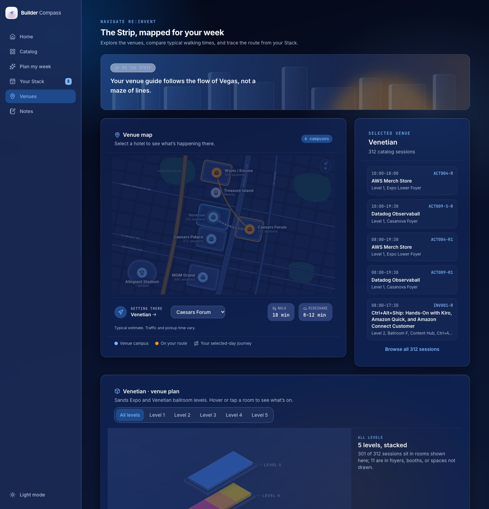

# Builder Compass

An independent, unofficial **AWS re:Invent 2026 session planner**. Search the full catalog, draft a week from your profile, check the walk between venues, explore each venue in 3D, and turn your notes into a trip report.

Everything runs in the browser on the real catalog (2,343 sessions). No account, no tracking, no backend.

> Not affiliated with or endorsed by Amazon Web Services.

| | |
|---|---|
|  |  |
|  |  |



## Features

- **Catalog:** search, day tabs, filters (track, role, level, type, venue, reservable), sort, and "ask in a sentence". Filters survive navigation.
- **Plan my week:** a profile (role, depth, interests, days, daily limit, goal) produces a draft week with a theme per day. A bring-your-own-AI step lets you paste a prompt into any assistant and import the reply.
- **Your Stack:** day timeline with walk checks between venues, free-gap suggestions, custom blocks, a reserve checklist, and calendar (`.ics`) export.
- **Venues:** a Strip map with walking and rideshare estimates, plus an isometric plan of each venue's levels and rooms linked to live session counts.
- **Notes:** rate each session, capture a takeaway, action items and notes, then export a trip report as Markdown.

## Run it

Requires Node 18.17 or newer.

```bash
npm install
npm run dev        # http://localhost:3000
```

| Script | What it does |
|---|---|
| `npm run dev` | Dev server |
| `npm run build` / `npm start` | Production build and server |
| `npm run lint` | ESLint (`next/core-web-vitals`) |
| `npm run typecheck` | TypeScript, no emit |
| `npm run convert-data -- <csv>` | Rebuild `data/*.json` from a catalog CSV |

Do not run `npm run build` while a dev or start server is running. They share `.next` and the build can fail or corrupt it.

## Pages

| Route | What it does |
|---|---|
| `/` | Overview and entry points |
| `/catalog` | Search, filters, sort, and how each session fits your stack |
| `/session/[id]` | Deep-linkable session page: details, speakers, fit with your stack, notes, related sessions |
| `/plan` | Profile, a draft week, and the bring-your-own-AI bridge |
| `/stack` | Stats, week overview, day timeline with walk checks, gap suggestions, custom blocks, reserve checklist, calendar export |
| `/map` | Strip map, travel estimates, isometric venue plans, and your route by day |
| `/notes` | Session list with progress, rating and note editor, Markdown export (`/report` redirects here) |

## How it works

- **Times** are formatted from the catalog's Pacific offset, so everyone sees Las Vegas time whatever their timezone. Custom blocks are entered in Las Vegas time.
- **Walk rating:** Reachable if the break is at least the walk plus 10 minutes; Tight if it covers the walk; Not reachable if shorter. Back-to-back sessions in the same venue are Reachable. Walk times in `data/venues.json` are estimates.
- **Planner:** fills each day in two passes: first only sessions whose walks keep the full 10-minute buffer, then tight walks if slots remain. The Stack page flags any tight walks instead of showing "All clear".
- **Drop-in items** (parties, expo, featured experiences) never create conflicts. The planner skips them unless you turn on events, and always skips all-day items.
- **Repeat sessions** run under several codes (`-R`, `-R1`, ...). The planner, gap suggestions and AI replies never add the same session twice.
- **Bring your own AI:** `/plan` builds a prompt from your profile and the best candidates. You paste it into any assistant, then paste the JSON reply back. Codes are validated against the catalog and overlaps are skipped.
- **Venue plans** (`lib/venuePlans.ts`) are simplified layouts condensed from published floor plans, not survey-accurate. Rooms are linked to sessions by matching room names; the first matching room wins.
- **Storage:** your plan, notes, ratings and preferences live in `localStorage` (key `builder-compass-v2`). They are per browser and per device.
- **Removing is safe:** taking a session out of the stack keeps its notes and rating (they come back if you add it again, and stay in the trip report). Every removal shows an Undo toast (also Cmd/Ctrl+Z).

## Project structure

```
app/                     pages: catalog, session/[id], plan, stack, map, notes
components/              shared UI; VenueIsoPlan is the isometric venue renderer
components/ui/           Button, Card, Chip, Segmented, EmptyState, PageHeader
components/plan/         ProfilePanel, AiBridge
lib/data.ts              client data access: fetches the catalog once (swap point for a backend)
lib/data.server.ts       server-only catalog access for the home and session pages
lib/schedule.ts          blocks, conflicts, walk fit, gaps, stats, suggestions
lib/planner.ts           week planner, AI prompt builder and reply parser
lib/search.ts            Fuse index, filters, sentence parser
lib/ranking.ts           profile scoring and reasons
lib/store.ts             saved plan and profile (localStorage, manual hydration)
lib/venuePlans.ts        isometric room layouts per venue
lib/walkGraph.ts         walk-time lookup and feasibility
lib/catalogView.ts       catalog filters and sort, kept across navigation
lib/ics.ts, markdown.ts  calendar and Markdown export
public/data/sessions.json  the catalog (generated, served as a static file)
data/venues.json         venue walk graph (generated, bundled)
scripts/convert-csv.mjs  builds the data files from the catalog CSV
public/maps/references/  venue floor-plan images shown in the venue plan card
branding/                logo, brand board, BRAND.md (design system)
docs/screenshots/        images used in this README
```

## Catalog data

`public/data/sessions.json` and `data/venues.json` are generated from the catalog CSV export and committed, so you do not need the CSV to run the app. To regenerate them:

```bash
npm run convert-data -- /path/to/reinvent2026_sessions.csv
```

The script normalizes venues (for example `TAP Sports Bar (located in MGM Grand)` becomes `MGM Grand`), maps types and levels, and writes both files.

## Where a backend would plug in

| Today | Later |
|---|---|
| `getSessions()` in `lib/data.ts` fetches `/data/sessions.json`; `getVenueGraph()` reads bundled JSON | API Gateway + Lambda or AppSync |
| `parseNaturalLanguage()` in `lib/search.ts` (rules) | Amazon Bedrock endpoint with the same output shape |
| The paste-in AI step on `/plan` | Direct call using the same prompt and reply contract |
| `lib/store.ts` saves to `localStorage` | Sync to a backend once accounts exist |

The catalog is not in the JavaScript bundle: pages fetch `/data/sessions.json` (about 3 MB, 620 KB gzipped) once and cache it. Session pages (`/session/[id]`) are prerendered at build time with their own title and description. Serving the catalog from an API with server-side filtering would shrink it further.

## Design system

Tokens, type and component rules live in `branding/BRAND.md`, `tailwind.config.ts` and `app/globals.css`.

## Notes for contributors

- The venue floor-plan images in `public/maps/references/` come from the venues' public meeting-space pages. The source link for each is shown in the app. Check the venues' terms before redistributing them.
- `npm audit` reports advisories against Next.js 14. The fixes require a major upgrade to Next 16, which has not been done yet.
